# Setting up your Ulanzi deck

An **Ulanzi D200** is a desk pad with fourteen clear keys over one screen. This turns it
into a control deck for **Home Assistant**: press a key to switch a light, run a scene or
change screen, and watch readings from your house on the keys themselves — a temperature
graph, a power dial, the time. You lay it out from a panel inside Home Assistant, with no
YAML and nothing typed into a terminal.

Six steps, and only one of them happens outside Home Assistant.

**You need** an Ulanzi D200, **a Mac** the deck plugs into and leaves plugged in, and
**Home Assistant 2026.11 or newer**. The Mac is not optional: the deck has no network of
any kind, so something has to sit on the computer it is cabled to. There is no Windows or
Linux version. The deck also has to let a computer in over USB, which mine did with nothing
asked for — whether every D200 does, I don't know. [Part 1](parts/01-the-deck/README.md)
has the one command that tells you.

 

<a href="images/ulanzi-d200.png">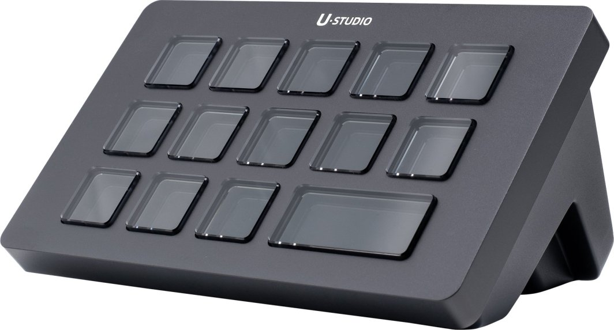</a>

 

### **[→ Try the panel in your browser first](https://sygad.github.io/ulanzi-d200-ha-deck/docs/try/)**

The real panel, running against a house that does not exist. Nothing is installed and
nothing of yours is touched. Press **PREVIEW** and the keys answer.

 

 

---

 

## What you need, and how it joins up

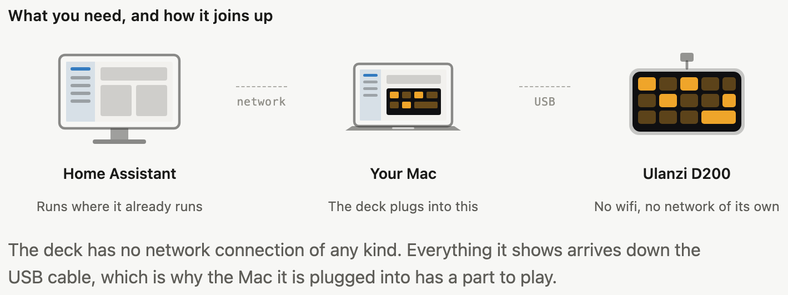

 

---

 

## 1 &nbsp; Download from the Marketplace

In **Settings → Marketplace**, press the three dots at the top right and choose
**Custom repositories**. Press **Add from link** at the bottom right, paste
`https://github.com/sygad/ulanzi-d200-ha-deck` and press **Add**. Nothing else is asked;
it works out what it is.

 

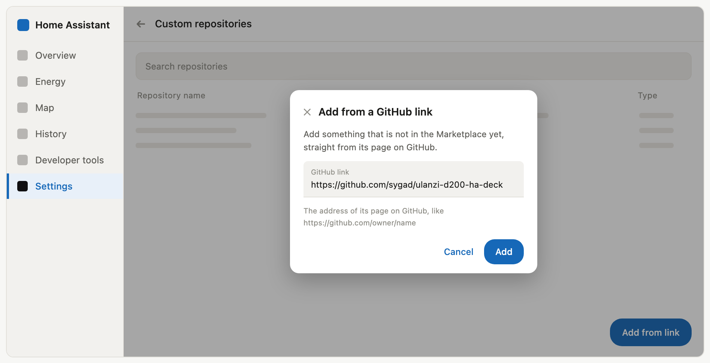

 
 

**Ulanzi Deck** is then in the list, as an Integration. Click that row.

 

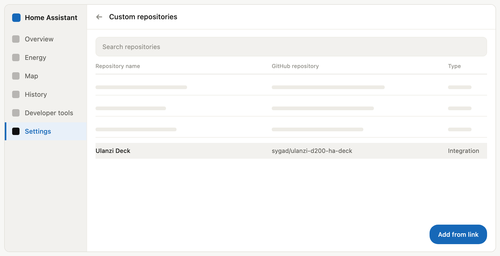

 
 

Its own page opens. Press **Install**.

 

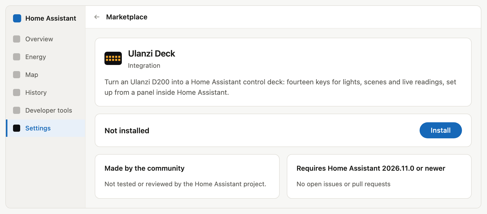

 

---

 

## 2 &nbsp; Restart Home Assistant

Home Assistant raises this itself after any new download. Nothing you have just
installed is running until it has restarted once.

If you miss the prompt: **Settings → System**, the power icon in the top right, then
**Restart Home Assistant**.

 

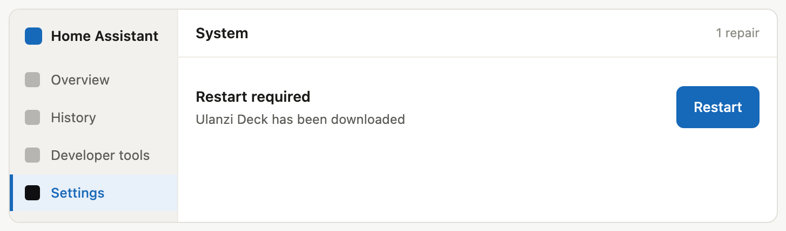

 

---

 

## 3 &nbsp; Add it under Devices & services

Downloading put the files in place; this switches it on. Go to **Settings → Devices &
services**, press **Add integration** at the bottom right, search for **Ulanzi Deck**
and pick it. It asks nothing — press Submit and it is done.

 

---

 

## 4 &nbsp; Open Ulanzi Deck in the sidebar

A new item appears down the left. Open it and press the one button on the page.

 

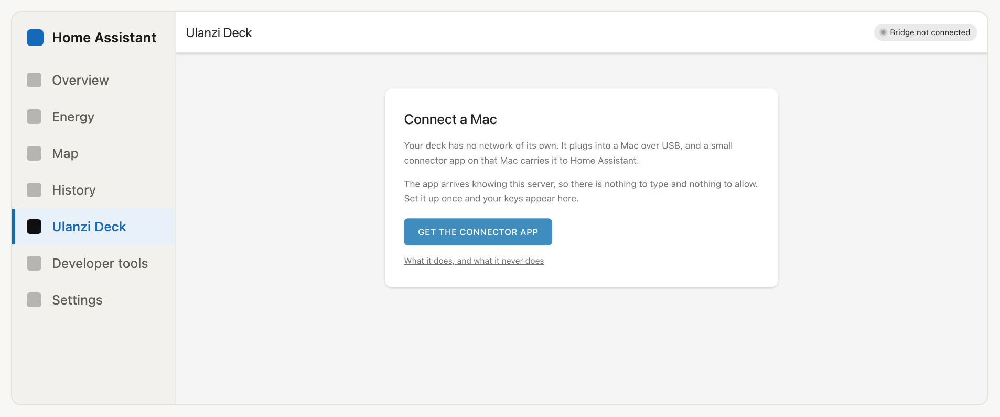

 

---

 

## What the connector app is, before you run it

Downloading a program from someone you have never met is a fair thing to be wary of.
So here is exactly what it is, and why it has to exist at all.

**Your deck has no network.** No wifi, no ethernet, no address of its own. Everything
it shows arrives down the USB cable. Home Assistant runs somewhere else on your
network and cannot see a USB device plugged into a different computer. Something has
to sit on the computer the cable goes into and pass messages along. That is the whole
job.

 

**What it does**

- ✅ &nbsp;Holds the USB connection and passes messages between the deck and your Home Assistant.
- ✅ &nbsp;Tells the deck the time, because the deck has no clock of its own.
- ✅ &nbsp;Copies the deck software across: at the start, and again whenever you update it. Ulanzi's own copy is kept the first time, so you can go back.

**What it never does**

- ❌ &nbsp;No account, no sign-in, no cloud service. Nothing of yours leaves your network.
- ❌ &nbsp;Talks to one address only: the Home Assistant you pointed it at.
- ❌ &nbsp;No analytics, no telemetry, nothing else running in the background.
- ❌ &nbsp;Never updates itself behind your back. Home Assistant offers a new version; you press the button.

 

Every line of it is published, the program that runs on the deck included. You can read
it, change it, or build the app yourself rather than download it.

 

---

 

## 5 &nbsp; Open the connector app

Open the zip. Three things are inside: the app, **Start here.html** — the same four steps as
below, with a button that opens System Settings where macOS wants you — and a small pairing
file.

 

**1. Double-click Ulanzi Deck.** Leave `ulanzi-deck-pairing.json` where it is: that is what
tells the app which Home Assistant is yours, so there is nothing to type and nothing to allow.

 

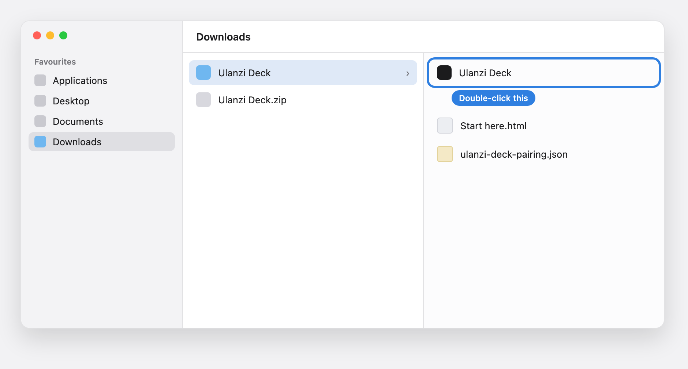

 
 

**2. macOS will stop you. Press Done** — **not** Move to Bin, however blue that button is. Every
Mac shows this for software not sold through Apple's own store. It means nobody has paid Apple to
vouch for it, not that anything is wrong with the app.

 

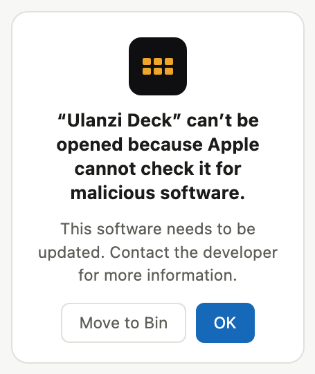

 
 

**3. Tell your Mac you meant it.** Open **System Settings → Privacy & Security**, scroll to
**Security**, and press **Open Anyway** beside Ulanzi Deck. It asks once more with Move to Bin in
blue: press **Open Anyway** again, the middle button. That is it, once, forever.

 

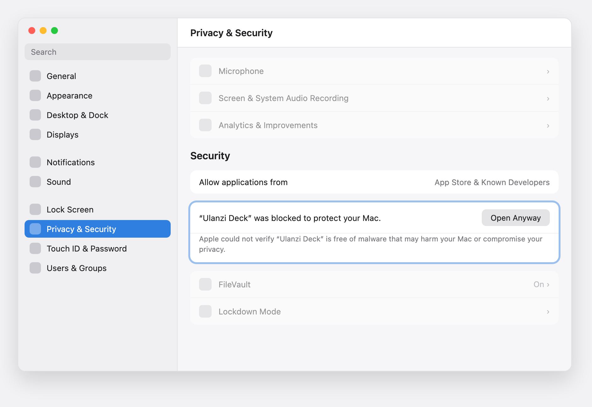

 
 

**4. Press Proceed.** The app opens and finds your Home Assistant by itself. **Plug the deck in
whenever you like** — before or after makes no difference. When both lights are green, press
**Proceed** and it sets the deck up in a few seconds.

It also puts itself in your **Applications** folder on that first run, so it disappears from
the download folder — that is meant to happen. From then on it is an app like any other, with
its icon in the menu bar beside the clock.

The app stays in the menu bar beside the clock. Closing its window does not stop it; **Quit** is in that menu, along with the version it is running — listed as **Connector app**, the same name the panel uses for it.

 

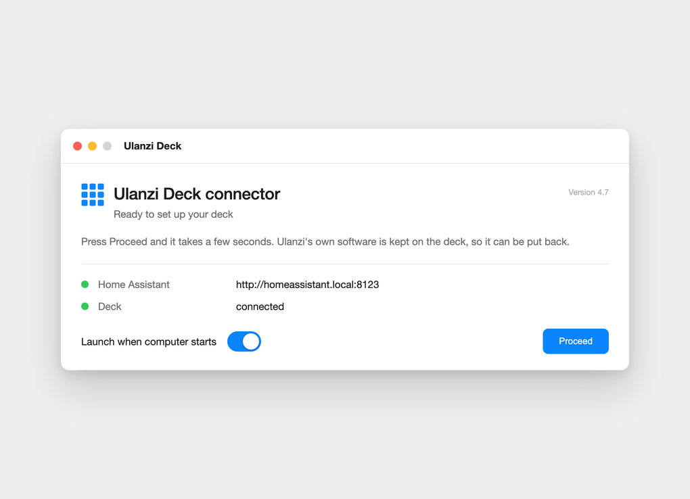

 

---

 

## 6 &nbsp; Customise your deck

Back in the same sidebar page. Pick a key, give it something to do, and press **Send to
device**. **Preview** lets you try a key in the browser before it ever reaches the deck.

<a href="images/guide/fig-step5.png">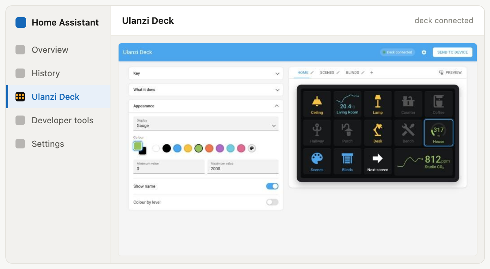</a>

 

---

 

## The screen: when it goes off, and how bright

The gear in the top bar, between the status and **Send to device**, opens **Deck settings**.
Two things live there, and both are about the deck's screen rather than the keys.

 

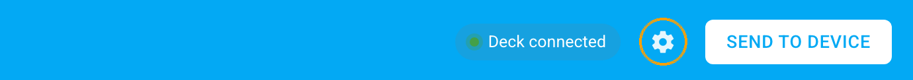

 
 

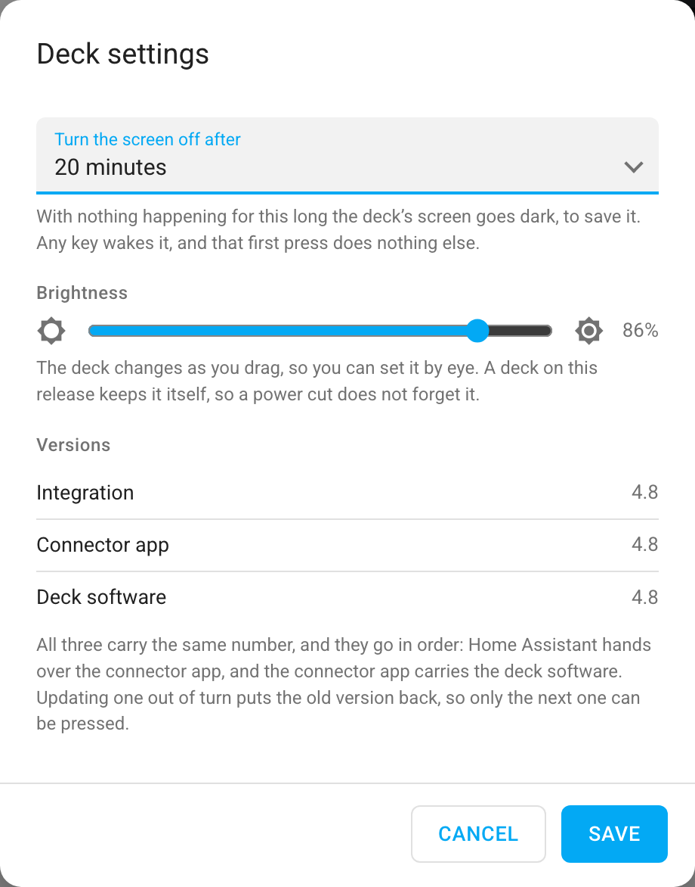

 

### Turn the screen off after

A deck showing the same fourteen keys to an empty room is a screen on for no reason, so the
deck blanks its own when nothing has happened for a while. **20 minutes** to start
with, and the dropdown offers **1, 2, 5, 10, 15, 20, 30 and 45 minutes**, then **1 hour,
1 hour 30, 2, 3 and 4 hours** — and **Never**, if you would rather it stayed lit.

Any key brings it back, and **that waking press does nothing else**: the press that lights
the screen never also works a light. Nothing is lost while it is dark — the deck keeps taking
updates from Home Assistant, so what you see on the way back is current, not what was there
when it went off.

This one is part of the layout, so a change to it reaches the deck when you press **Send to
device**, along with everything else you have altered.

### Brightness

The slider runs from about 4% to full. **The deck follows your finger as you drag**, so set it
by eye against the room rather than guessing at a number — the panel is only a few milliseconds
down the cable from the Mac.

The lowest setting is dim but never off. Off is what the timeout above is for.

Two things make this one behave differently from everything else in the panel:

- **It does not wait for Send to device.** The brightness is already on the deck by the time
  you let go of the slider, and the deck writes it down itself, so a power cut does not forget it.
- **Cancel puts the light back.** If you drag it somewhere you do not like, Cancel returns the
  deck to where it was before you opened the dialog.

 

---

 

## Keeping it up to date

There are three parts — the **integration** inside Home Assistant, the **connector app** on
your Mac, and the **deck software** on the deck itself. They are released together and all
carry the same number, so any part showing a lower one is simply behind.

A line under the panel always says where all three are. Grey means there is nothing to do;
amber means that part is behind, and a bar appears above the line with the one thing to do
next — never a list of them, and always in the order they have to happen:

1. **Integration** — comes from the Marketplace, and Home Assistant has to restart before the
   new one is the one running. Until it has, the panel says so rather than letting you chase
   the other two.
2. **Connector app** — the integration hands it over. **Update now** tells the Mac to fetch it.
   The app offers it in its own window and in the menu bar too.
3. **Deck software** — the connector app copies it across, so it can only install the version
   that app is carrying. That is why it comes last. The deck restarts, which takes a few seconds.

The app's update is fetched by your Home Assistant and handed to the Mac over the connection
the Mac is already on, so macOS does not ask about it again — the warning and the two Open
Anyways happen once in the life of the app.

## How it is built

Six pages, one per piece, for anyone who wants to see inside it or build their own.
None of this is needed to set a deck up.

| | |
|---|---|
| [Part 1 · The deck](parts/01-the-deck/README.md) | What an Ulanzi D200 actually is, read off the hardware |
| [Part 2 · The deck software](parts/02-deck-app/README.md) | The program that runs on the deck. One C file, no libraries at all |
| [Part 3 · The connector app](parts/03-mac-bridge/README.md) | The Mac app the deck plugs into |
| [Part 4 · The integration](parts/04-home-assistant/README.md) | The part that does the thinking, inside Home Assistant |
| [Part 5 · The panel](parts/05-the-panel/README.md) | Where you set the deck up |
| [Part 6 · Lining up the keys](parts/06-lining-up-the-keys/README.md) | How the key positions were measured |

The [message formats](shared/README.md) both ends agree on are written down too.

 

---

 

**Licence** — [MIT](LICENSE). Fonts and icons keep their own licences, listed in [NOTICE.md](NOTICE.md).

**Credits** — **Roboto** by Google, Apache 2.0. **Material Design Icons** by [Pictogrammers](https://pictogrammers.com/library/mdi/). `adb`, carried inside the connector app, Apache 2.0. Ulanzi's own software is not included here. Not affiliated with Ulanzi or with Home Assistant.
