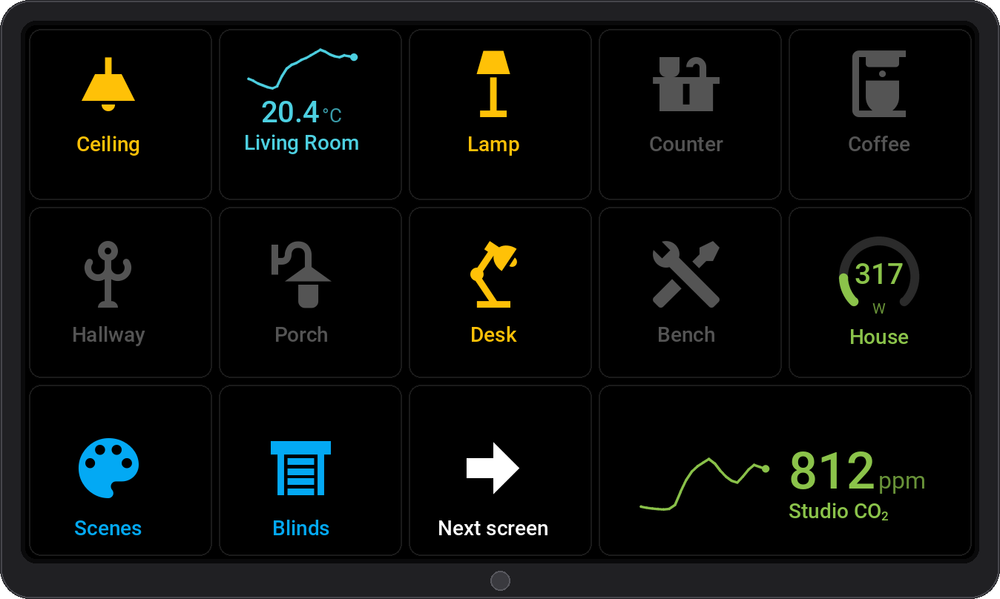
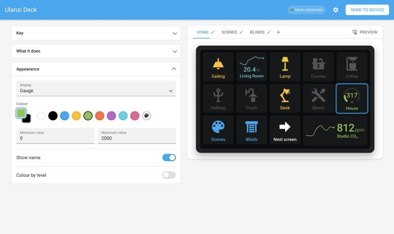
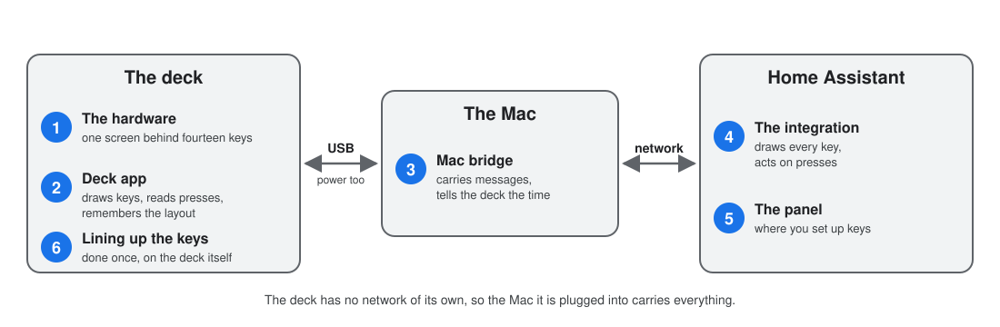

# Ulanzi D200 Home Assistant Control Deck

Turns an Ulanzi D200 stream deck into a Home Assistant control surface. Its fourteen
keys toggle lights, run scenes and switch screens, and show sensor readings as
numbers, bars, dials and graphs. You set it all up from a panel inside Home Assistant.

<!-- TODO: video goes here once recorded.
[](https://www.youtube.com/watch?v=VIDEO_ID)
-->

**On the deck** — one of its screens, drawn by the deck itself. Click any picture to see it full size.

<a href="images/deck.png"></a>

**In Home Assistant** — where you set it all up, with a live preview of the deck beside you.

<a href="images/panel.jpg"></a>

Everything shown is the made-up house in [`tools/demo_house.py`](tools/demo_house.py), which the repo
comes with. No real home is pictured anywhere in here.

---

## Try it before you do anything else

**[Open the panel in your browser →](https://sygad.github.io/ulanzi-d200-ha-deck/docs/try/)**

That is the real panel from this repo, running on a made-up house. Nothing is installed and
nothing of yours is touched. Press **PREVIEW** on the right and you can press the keys and
watch them answer, exactly as the deck does. It is the quickest way to see whether this is
for you.

**[The setup guide, step by step →](https://sygad.github.io/ulanzi-d200-ha-deck/docs/)**

Five steps with a picture of each one. Three happen inside Home Assistant, and nothing is
typed into a terminal.

---

## ⚠️ Read this before you start

- **It replaces the app on the deck.** Ulanzi's own software will not see the deck
  while this is installed. The vendor app is saved first and one command puts it
  back: see [Part 2](parts/02-deck-app/README.md#going-back).
- **The bridge is Mac only.** The deck has no network of its own, so the computer it
  is plugged into carries its traffic. That piece is written for macOS. There is no
  Windows or Linux bridge yet.
- **It has been built and tested on one deck.** Mine. Where something might differ on
  yours, the page says so.

---

## How this repo works

Every piece has a **number**, and that number is used everywhere: in the picture
below, in the table, in the folder name. Drop in at any part without reading the rest.

```
README.md                         this page
BUILD-WITH-AI.md                  point your own AI at the repo and let it do the install
docs/                             the setup guide, and the panel running in your browser
custom_components/ulanzi_deck/    the Home Assistant integration (Parts 4 and 5), where
                                  Home Assistant and HACS expect to find it
parts/
  01-the-deck/                    what is inside a D200, and how to get in
  02-deck-app/                    the app that runs on the deck: source, a ready-made
                                  binary, and the installer
  03-mac-bridge/                  the Mac agent that carries messages: source and installer
  04-home-assistant/              installing the integration, and what it gives you
  05-the-panel/                   setting up keys and screens
  06-lining-up-the-keys/          telling the deck where its own keys are
shared/                           things several parts rely on: the wire format, the layout
                                  file, the sizing rule
tools/                            small helpers for working on it
```

**Pick your route:**

| I want to… | Go to |
|---|---|
| Have an AI install it for me | [BUILD-WITH-AI.md](BUILD-WITH-AI.md) |
| Install all of it myself | [Quick start](#quick-start) |
| Understand one piece | [The parts](#the-parts): open that part's folder |

---

## The parts



| # | Part | What it does | Built from |
|---|---|---|---|
| 1 | [The deck](parts/01-the-deck/README.md) | The hardware: one screen behind fourteen clear keys, a small Linux computer, USB only | Ulanzi D200 |
| 2 | [Deck app](parts/02-deck-app/README.md) | Runs on the deck. Draws the keys, reads presses, remembers the layout | One C file, no libraries |
| 3 | [Mac bridge](parts/03-mac-bridge/README.md) | Runs on the Mac. Carries messages between the deck and Home Assistant, and tells the deck the time | One Swift file, no dependencies |
| 4 | [Home Assistant integration](parts/04-home-assistant/README.md) | Draws every key, sends it to the deck, and acts on presses | A custom integration, Python |
| 5 | [The panel](parts/05-the-panel/README.md) | Where you set up keys and screens, with a live preview you can press | A sidebar panel, part of the integration |
| 6 | [Lining up the keys](parts/06-lining-up-the-keys/README.md) | Finds where each key's window sits over the screen, so content is centred | A tool built into the bridge |

Things used by more than one part are explained once, in [shared/README.md](shared/README.md).

---

## What you need

### Hardware

| What | Notes |
|---|---|
| Ulanzi D200 stream deck | 13 keys plus one double-width key. Sold by [Ulanzi](https://www.ulanzi.com). Its case is printed U·STUDIO |
| A Mac | The deck plugs into it by USB and is powered by it. Apple silicon is what I tested |
| A USB **data** cable | The one that came with the deck |
| A Home Assistant server | On the same network as the Mac. It does not need to be the Mac |

### Downloads

| What | Needed for | Get it |
|---|---|---|
| Xcode Command Line Tools | Building the bridge (Part 3) | Run `xcode-select --install` |
| Android platform tools (`adb`) | Putting the app on the deck (Part 2) | `brew install android-platform-tools`, or [download from Google](https://developer.android.com/tools/releases/platform-tools) |
| [Homebrew](https://brew.sh) | The easy way to get `adb` | Optional |
| This repo | Everything | `git clone`, or the green **Code** button and Download ZIP |
| `lld` linker | Only if you want to rebuild the deck app yourself. A ready-made binary is in [Part 2](parts/02-deck-app/README.md) | `brew install lld` |
| Python 3 with Pillow | Only for the helper scripts in `tools/` | `pip install pillow` |

Nothing is downloaded onto the deck from the internet. The app is copied to it over USB.

### Tested with

| | Version |
|---|---|
| Home Assistant | 2026.11.1 |
| macOS | 26.6.2, Apple silicon |
| Swift | 6.3.3 (from the Command Line Tools) |
| adb | 1.0.41 |
| The deck | Buildroot 2021.11, Linux 5.10.160; vendor app built 20 May 2025 |

---

## Quick start

Each step points at the page that has the detail.

1. **Check the Mac can see the deck.** Plug it in and run `adb devices`. One device
   should be listed. More in [Part 1](parts/01-the-deck/README.md).
2. **Put the app on the deck.** `./parts/02-deck-app/install.sh`. It saves the vendor
   app first. The wide key should then read "Waiting for Home Assistant".
   [Part 2](parts/02-deck-app/README.md).
3. **Install the integration.** Copy `custom_components/ulanzi_deck` into your Home
   Assistant `config/custom_components` folder, restart Home Assistant, and add
   **Ulanzi Deck** under Settings → Devices & services. [Part 4](parts/04-home-assistant/README.md).
4. **Start the bridge.** `./parts/03-mac-bridge/install.sh http://homeassistant.local:8123`,
   with your own Home Assistant address. [Part 3](parts/03-mac-bridge/README.md).
5. **Allow the bridge.** Open **Ulanzi Deck** in the Home Assistant sidebar and press
   **Allow**. The chip beside it should change to "Deck connected".
6. **Set up your keys.** Pick a key, give it something to do, and press
   **Send to device**. [Part 5](parts/05-the-panel/README.md).
7. **If content sits off-centre in the keys,** line them up.
   [Part 6](parts/06-lining-up-the-keys/README.md).

Steps 1 to 5 take a few minutes. Step 6 is yours and has no end.

### You start with a blank deck

The panel opens on one empty screen. Nothing is set up for you, on purpose: a key
pointing at a light you do not own is worse than no key. Press a **+**, pick one of
your own entities, press **Send to device**, and it is on the deck a second later.

The screens in the pictures above are a demonstration, built from a house that does
not exist ([`tools/demo_house.py`](tools/demo_house.py)). They are there to show what
a key can be — a light, a scene, a script, a reading drawn as a number, a bar, a dial
or a graph, a clock, a jump to another screen — not to be copied. **Preview**, at the
right of the screen tabs, lets you press a key in the browser and watch it work before
it ever reaches the deck.

---

## Things to know

| | |
|---|---|
| **The deck needs the Mac** | It is powered over USB and has no network. Mac off, deck off |
| **It starts fast** | The deck draws its last layout from its own memory as soon as it has power, before the bridge is running |
| **A dot means not connected** | Top right of the wide key: red for no bridge, amber for a bridge with no Home Assistant behind it. Keys do nothing until it clears |
| **Nothing is queued** | A press made while disconnected is dropped, not saved up |
| **The screen turns itself off** | After 20 minutes with nothing happening, to save the panel. Any key wakes it, and that waking press does nothing else. Set it, or turn it off, with the gear in the panel's top bar |
| **It froze once** | During development the deck stopped completely, screen lit and not answering, and needed its cable pulled. It has not happened again and I have not found the cause |

---

## Licence

[MIT](LICENSE): use, copy and change anything here, for any purpose.

The fonts and icons bundled with the integration keep their own licences, listed in
[NOTICE.md](NOTICE.md). Ulanzi's own software is not included in this repo.

## Credits

- **Roboto** by Google, [Apache License 2.0](http://www.apache.org/licenses/LICENSE-2.0).
- **Material Design Icons** by [Pictogrammers](https://pictogrammers.com/library/mdi/),
  under the Pictogrammers Free License (fonts and icons: Apache License 2.0).
- Not affiliated with Ulanzi or with Home Assistant.
