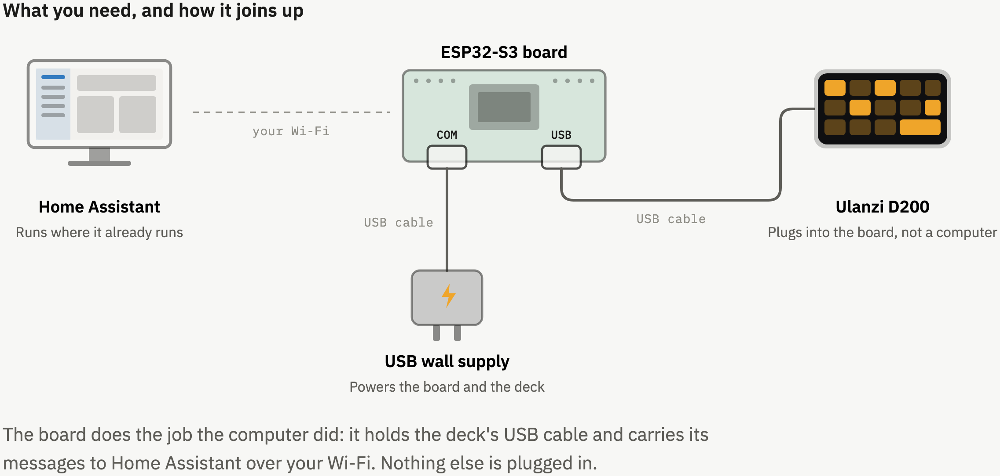
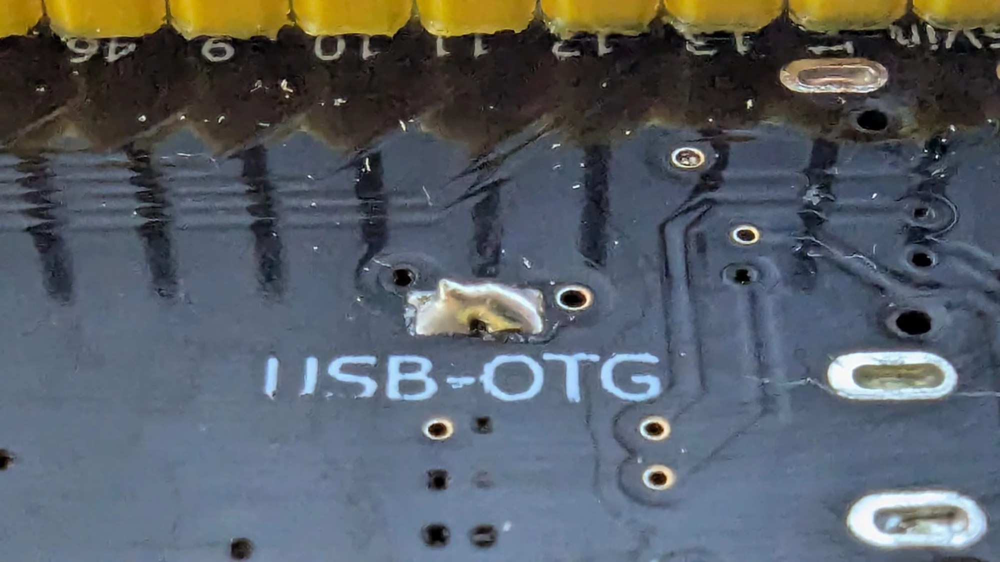
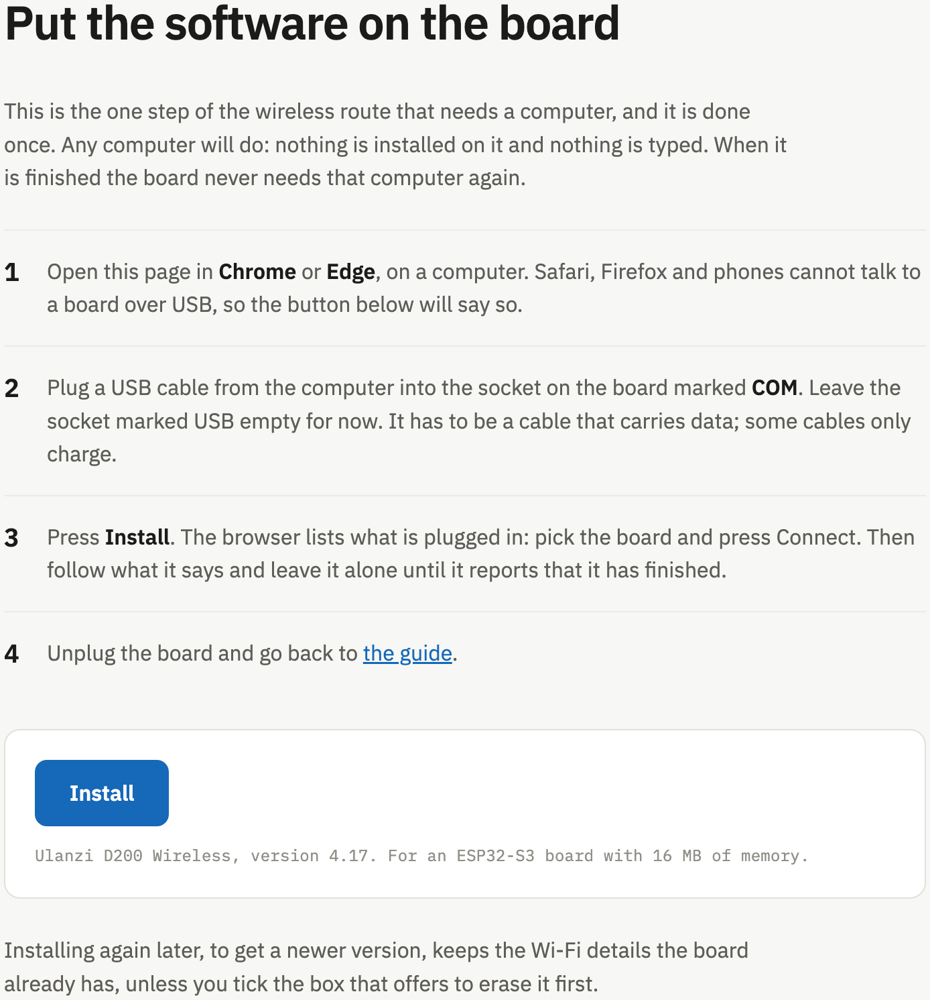
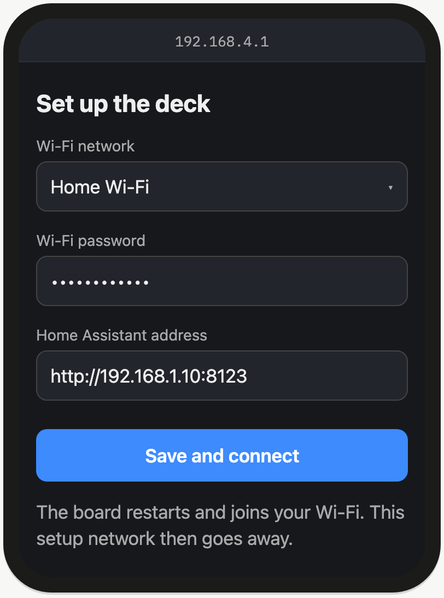
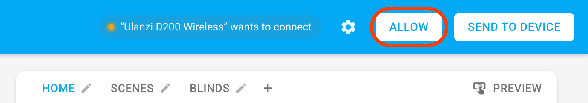
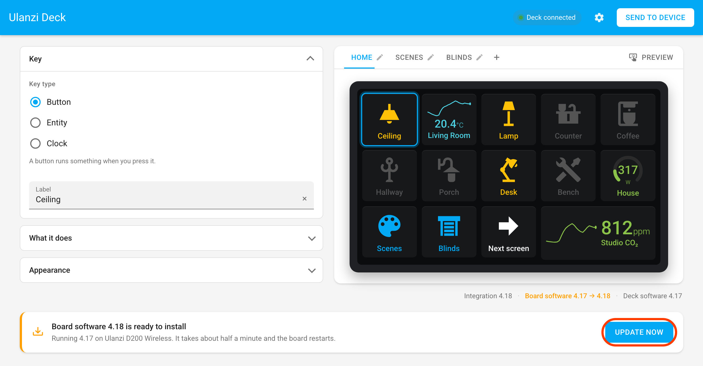
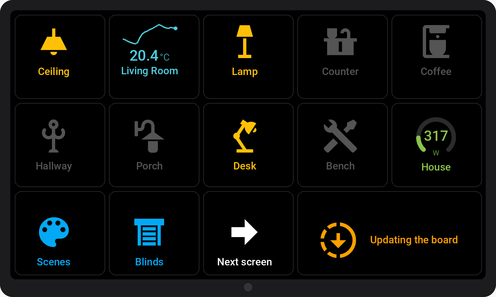

[← The main guide](README.md)

# Setting up your Ulanzi deck with no computer

The deck has no network of its own, so something has to hold its USB cable and carry
its messages to Home Assistant. In [the main guide](README.md) that something is a Mac
running the connector app. Here it is a small **ESP32-S3 board** on a phone charger.
The deck sits wherever there is a wall socket and Wi-Fi, and no computer is involved
once it is set up.

Everything else is the same deck, the same panel in Home Assistant and the same keys.

**This route is new.** It has been built and run on one deck and one board: mine. Where I
can't say something holds for yours, this page says so. [What is not finished yet](#what-is-not-finished-yet)
is listed at the end, and is worth reading before you buy anything.

 

## Which route is for you

| | With a Mac ([the main guide](README.md)) | With the board (this page) |
|---|---|---|
| **The deck plugs into** | A Mac, which stays on | The board, on a wall supply |
| **To buy** | Nothing | An ESP32-S3 board and a wall supply |
| **Soldering** | None | One blob of solder across two pads |
| **Software to install** | The connector app, on the Mac | The board's software, once, from a web page |
| **Works with the computer off** | No | Yes |
| **Updates** | From the panel in Home Assistant | From the panel in Home Assistant |

 

---

 

## What you need, and how it joins up

 

| | |
|---|---|
| **An Ulanzi D200** | The same as for the other route. It has to let a computer in over USB, which mine did with nothing asked for. [Part 1](parts/01-the-deck/README.md) says how to check |
| **An ESP32-S3 board with two USB-C sockets** | The kind sold as **ESP32-S3 DevKitC-1 N16R8**: one socket marked **COM**, one marked **USB**, 16 MB of memory, and a pair of solder pads marked **USB-OTG** on the back. Mine is a diymore one. A board without those pads, or with less memory, has not been tried |
| **A soldering iron and solder** | For one blob of solder. Nothing is removed and no wire is added |
| **A USB wall supply and a cable to the board** | A phone charger. It powers the board and, through it, the deck. Any USB cable will do for this one: it only carries power. I have not measured what the deck draws |
| **A USB data cable from the board to the deck** | This one has to carry data, because the deck's messages travel down it. A charge-only cable will light the deck and nothing more |
| **A computer with Chrome or Edge, and a USB data cable to it** | Once, for a few minutes, to put the software on the board. Any computer will do. The cable has to carry data here too; the one for the deck can be borrowed for it |
| **Home Assistant 2026.11 or newer** | And a Wi-Fi network the board can join. An ESP32-S3 uses the 2.4 GHz band only |

 

---

 

## 1 &nbsp; Bridge two pads on the board

Out of the packet, the board keeps its two sockets' power apart: power going in at **COM**
does not come out at **USB**. A deck plugged into it stays dark. On the back of the board
is a pair of small pads marked **USB-OTG**. A blob of solder across them joins the two.

 

The silver blob just above the printing is the join.

 
 

- **Only those two.** There are other pairs of pads on the front, marked **IN-OUT** and
  **RGB**. Leave them as they are.
- **Go by the printing, not the position.** Makers lay these boards out differently. The
  pads you want are the ones printed USB-OTG.
- **From now on, never plug both sockets into computers at the same time.** The two now
  share their 5 volts, so two computers would be feeding each other.

 

---

 

## 2 &nbsp; Put the software on the board

Plug the board's **COM** socket into a computer with a data cable, and open this page in
Chrome or Edge:

### **[→ Install the board's software](https://sygad.github.io/ulanzi-d200-ha-deck/docs/flash/)**

Press **Install**, pick the board from the list the browser shows, and leave it until it
says it has finished. Nothing is installed on the computer and nothing is typed. This is
the only time the board needs one.

 

 

---

 

## 3 &nbsp; Join it up

Unplug the board from the computer. Then:

1. Plug the **deck** into the socket marked **USB**, with the data cable.
2. Plug the **wall supply** into the socket marked **COM**. Any USB cable will do for this.

The deck lights up. If it stays dark, the pads in step 1 are not joined.

 

---

 

## 4 &nbsp; Tell the board your Wi-Fi

A board that has not been set up makes a Wi-Fi network of its own, called **Ulanzi Deck
Setup**. It has no password, and it goes away as soon as the board has joined yours.

1. On a phone or a computer, join **Ulanzi Deck Setup**.
2. Open `http://192.168.4.1` in a browser. A page titled **Set up the deck** appears.
3. Choose your **Wi-Fi network** from the list and type its **password**.
4. Type your **Home Assistant address**, the one you open Home Assistant at, as numbers:
   something like `http://192.168.1.10:8123`.
5. Press **Save and connect**.

 

 

The board restarts and joins your Wi-Fi. If it can't, because the password was wrong or
the network is out of reach, it offers **Ulanzi Deck Setup** again after a minute, and you
start this step again.

 

---

 

## 5 &nbsp; Allow it in Home Assistant

If Home Assistant does not have the integration yet, do steps 1 to 4 of
[the main guide](README.md) first: download it from the
Marketplace, restart, add it, and open **Ulanzi Deck** in the sidebar. Stop there. The page
will offer you the connector app; that is the other route, and you don't need it.

At the top of the Ulanzi Deck page the status now reads
**"Ulanzi D200 Wireless" wants to connect**, with an **Allow** button beside it. Press
**Allow**.

 

 

Home Assistant asks this once. It is how it knows the board is yours and not something
else on your network claiming to be a deck.

 

---

 

## 6 &nbsp; The board sets the deck up

Nothing to do here but wait a few seconds.

The first time a deck is plugged into it, the board copies the deck software across. It
keeps Ulanzi's own software safe on the deck first, so you can go back. The deck restarts,
and the status at the top of the panel turns to **Deck connected**.

From here on it is the same as the other route: carry on at
[step 6 of the main guide, Customise your deck](README.md).

 

---

 

## What the board is, before you trust it

It is fair to be wary of software you put on a thing that then sits on your network.
Here is all of what it does.

**What it does**

- ✅ &nbsp;Holds the deck's USB cable and passes messages between the deck and your Home Assistant.
- ✅ &nbsp;Tells the deck the time, which it reads from your Home Assistant. A clock key on the deck follows the time zone your Home Assistant is set to, and changes with it when the clocks go forward or back.
- ✅ &nbsp;Copies the deck software across: the first time, and again whenever the board carries a newer one. Ulanzi's own copy is kept the first time.
- ✅ &nbsp;Shows where it stands on a page of its own. Open the board's address on your network in a browser.

**What it never does**

- ❌ &nbsp;No account, no sign-in, no cloud service. Nothing of yours leaves your network.
- ❌ &nbsp;Talks to one address only: the Home Assistant you gave it.
- ❌ &nbsp;No analytics and no telemetry.

**What you should know**

- Your Wi-Fi password is kept on the board so it can rejoin after a power cut. It is not encrypted there.
- The setup network in step 4 has no password. It exists only while the board has no Wi-Fi of its own to join.
- The board fetches new software for itself from one place only, your Home Assistant, and only when you press **Update now** in the panel.
- The board will also take new software, and run a command on the deck, for anyone on your network who has the board's own key. That key never leaves the board except down the cable in its COM socket. It is there for working on the project, and [Part 7](parts/07-wireless-board/README.md) describes it.

Every line of it is published in [Part 7](parts/07-wireless-board/README.md), and you can
build it yourself instead of using the web page.

 

---

 

## If something is not right

| What you see | What it means | What to do |
|---|---|---|
| The deck stays dark | No power is reaching it through the board | Check the pads in step 1 are joined, and try a different wall supply |
| No **Ulanzi Deck Setup** network | Either the software is not on the board, or the board has already joined a Wi-Fi network | Do step 2 again. If it has joined a network, see the next row |
| You need to change the Wi-Fi or the Home Assistant address | The board only offers its setup network when it can't get on to Wi-Fi | Hold the board's **BOOT** button for five seconds. It offers **Ulanzi Deck Setup** again |
| The panel never says "wants to connect" | The board can't reach Home Assistant at the address you gave it | Open the board's own page (below) and read what it says about Home Assistant |
| The deck lights up but shows a red dot on its wide key | The board is not talking to it. Most often the cable between them only carries power | Use a data cable between the board and the deck. If it already is one, unplug the deck from the board and plug it back in |
| The deck shows an amber dot | The board is fine but has lost Home Assistant | It reconnects by itself when Home Assistant is back |

**The board's own page.** Once it is on your Wi-Fi, the board answers at its own address
in a browser. Your router's list of connected devices has that address. The page says
whether it has joined Wi-Fi, whether Home Assistant has allowed it, and whether the deck
is answering.

 

---

 

## Keeping it up to date

There are three parts on this route: the **integration** inside Home Assistant, the
**board's software**, and the **deck software** on the deck itself.

They are released together and carry the same number, and the panel shows where all
three are, exactly as it does on the other route.

1. **Integration** — from the Marketplace, as in [the main guide](README.md#keeping-it-up-to-date).
2. **The board** — the panel then says **Board software … is ready to install**. Press
   **Update now**. Home Assistant sends the board its new software over your Wi-Fi; the
   integration carries it, so nothing is fetched from the internet. It takes about half a
   minute and the board restarts by itself. Nothing is unplugged.
3. **Deck software** — nothing to do. The board carries the deck software that matches it,
   and copies it across by itself as soon as it has restarted.

 

 
 

While it happens, the deck's bottom-right key shows an amber **Updating the board** in
place of whatever you put there. The keys stop answering for a few seconds, and this is
how you know that is meant to happen. It goes back to your own key by itself when the
update is done.

 

 

**A board from before 4.16 can't be told from the panel.** The panel says so and offers the
install page instead: plug the board's **COM** socket into a computer and press **Install** on
[the same page as step 2](https://sygad.github.io/ulanzi-d200-ha-deck/docs/flash/) once more. It keeps your Wi-Fi details,
and from then on its updates come from the panel.

 

---

 

## What is not finished yet

- **One deck, one board.** Everything here has been run on my deck and my board and no others.
- **The install page in step 2 has not written to a board yet.** My own board was loaded
  the developer's way, down the cable, before that page existed. If the page fails for
  you, [Part 7](parts/07-wireless-board/README.md#building-it-yourself) has the other way,
  and I would like to hear about it.
- **The BOOT button has not been tried.** Holding it for five seconds is meant to bring the
  setup network back. It is written and not yet pressed.
- **The Home Assistant address has to be numbers.** A name such as `homeassistant.local` has
  not been tried and I don't expect it to work.
- **The first page of the panel only knows the Mac route.** Until something connects, the
  panel offers the connector app and nothing else. Step 5 above says to leave that button;
  once the board has connected, the panel calls it a board throughout.
- **A Home Assistant reached over https has not been tried.** The board fetches its updates
  from the address you gave it in step 4, and I have only run that with an `http://` address.
- **A rare restart.** Once, while I was unplugging and plugging the deck to test it, the board
  crashed and restarted by itself. It was carrying the deck again a few seconds later, and
  I have not been able to make it happen again. The board now keeps a record of any crash
  so the next one can be explained.

 

---

 

**How it is built** — [Part 7 · The wireless board](parts/07-wireless-board/README.md).

[← The main guide](README.md)
