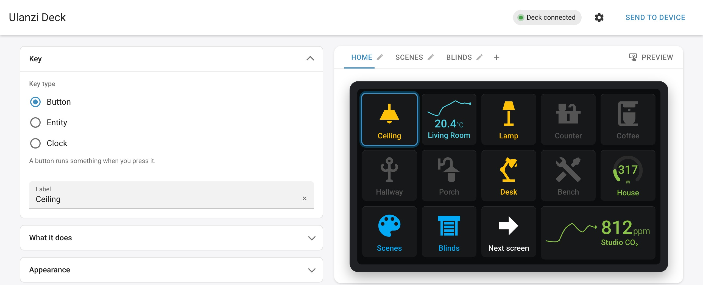
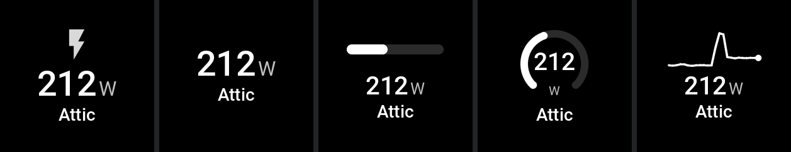

[← Part 4](../04-home-assistant/README.md) · [All parts](../../README.md) · [Part 6 →](../06-lining-up-the-keys/README.md)

# Part 5 · The panel



Where you set the deck up. Settings on the left, a live preview of the deck on the
right. It is meant to feel as though Home Assistant built it: the same fields,
pickers and switches as the card editor.

## At a glance

| | |
|---|---|
| **Built from** | A custom sidebar panel, plain JavaScript, no framework. Part of the integration |
| **Files** | [`custom_components/ulanzi_deck/frontend/`](../../custom_components/ulanzi_deck/frontend): `panel.js`, the icon font, and the icon names |
| **Also needs** | The integration ([Part 4](../04-home-assistant/README.md)) |
| **Reads** | Your entities, areas and their history, live from Home Assistant |
| **Open it** | **Ulanzi Deck** in the sidebar (admins only) |

## Using it

| To… | Do this |
|---|---|
| Set up a key | Click it in the preview. Its settings appear on the left |
| Move a key | Drag it onto another. The two swap |
| Remove a key | Hover it, open the three-dot menu, press **Delete** twice |
| Add a screen | The **+** after the screen tabs |
| Rename or delete a screen | The pencil beside its tab |
| Change when the screen turns off | The gear in the top bar, under **Turn the screen off after** |
| Try a key before sending it | **Preview**, at the right of the screen tabs. Keys then do what they say |
| Put it on the deck | **Send to device**, top right. It reads "Sent" when there is nothing waiting |
| Get the companion app | **Get the companion app**, on the card shown until a Mac is connected |
| Update the companion app | **Update now**, in the banner under the panel when a newer one exists |
| Pair a Mac that has no key | **Allow**, which appears in the top bar. A Mac set up from the download
  arrives with a key and never asks |

Every change is saved as you make it. Nothing reaches the deck until **Send to device**,
the screen-off time included.

### Preview

**Preview**, at the right of the screen tabs, turns the picture of the deck into a
working one. A key pressed there does what it says — toggles the light, runs the
script, changes screen — using the changes you have not sent yet, so a key can be
tried before it goes to the device. Tap and hold work as they do on the deck: half a
second is a hold, and a key with nothing set for hold acts the moment it is pressed.
A line under the tabs says what each press did.

While preview is on, keys cannot be selected, dragged or deleted; turn it off to carry
on editing. Screen keys move the preview and nothing else. **Nothing is sent to the
deck**: it goes on showing whatever you last sent it. Everything else is real — a
light key really does switch the light.

### Turning the screen off

The deck's panel is lit for as long as it has power, which is as long as the Mac is
on, so it turns itself off after a spell with nothing happening — 20 minutes unless
you say otherwise, and **Never** if you would rather it stayed lit. Any key brings it
back, and that first press does nothing else, so waking the deck cannot switch a light
on by accident.

The deck does this itself rather than being told to by Home Assistant, so it still
happens if the bridge or Home Assistant is down. The time travels in the layout
([shared](../../shared/README.md#the-layout-file), byte 15), so the deck keeps it over
a power cut.

## The three kinds of key

| Kind | What it is for |
|---|---|
| **Button** | Does something when pressed. A tap and a hold can each do a different thing |
| **Entity** | Shows a reading from Home Assistant, and redraws when it changes |
| **Clock** | Shows the time, kept by the deck itself. 12 or 24 hour, with optional seconds and date |

### Five ways to show a reading



| Display | Shows |
|---|---|
| **Icon** | A small icon over the reading |
| **Number** | The reading alone |
| **Bar** | A bar filled between the minimum and maximum you set |
| **Gauge** | A dial, with the reading inside it |
| **Graph** | The last 24 hours as a line |

Bar, Gauge and Graph can be **coloured by level**: green, then amber above one value,
then red above another, both in the sensor's own units.

## Settings I chose

- **Tap and hold are both on screen at once**, each with its own target. No hidden
  mode to switch.
- **Pickers search the way Home Assistant's do.** Type words in any order:
  `kitchen counter`, `counter kitchen` and `light.kitchen_counter` all find the
  kitchen counter lights.
- **One row of colours, two squares.** A key has two colours, the icon and text and
  the key behind them. Two overlapping squares show which is which; click one and the
  swatches set that one.
- **The wide key can be arranged.** Stacked, graphic on the left, or graphic on the
  right. On a single key there is only room to stack.
- **Sizes follow one rule.** On a key 100 wide, an icon is 54 and a label is 14, and
  everything else scales to match. The preview and the deck use the same numbers
  ([shared · the sizing rule](../../shared/README.md#the-sizing-rule)).
- **No save buttons and no "changed" markers.** You should never have to keep track
  of what you have touched.

## Working on the panel itself

`tools/panel-harness/` runs the panel in a browser against a pretend Home Assistant,
so it can be changed without a deck or a real server. Its house is the made-up one in
[`tools/demo_house.py`](../../tools/demo_house.py), and `python3 tools/make_demo_data.py`
rebuilds its data after you change it:

```bash
python3 tools/panel-harness/serve.py 8788
```

Then open `http://127.0.0.1:8788/`.

---

[← Part 4](../04-home-assistant/README.md) · [All parts](../../README.md) · [Part 6 →](../06-lining-up-the-keys/README.md)
