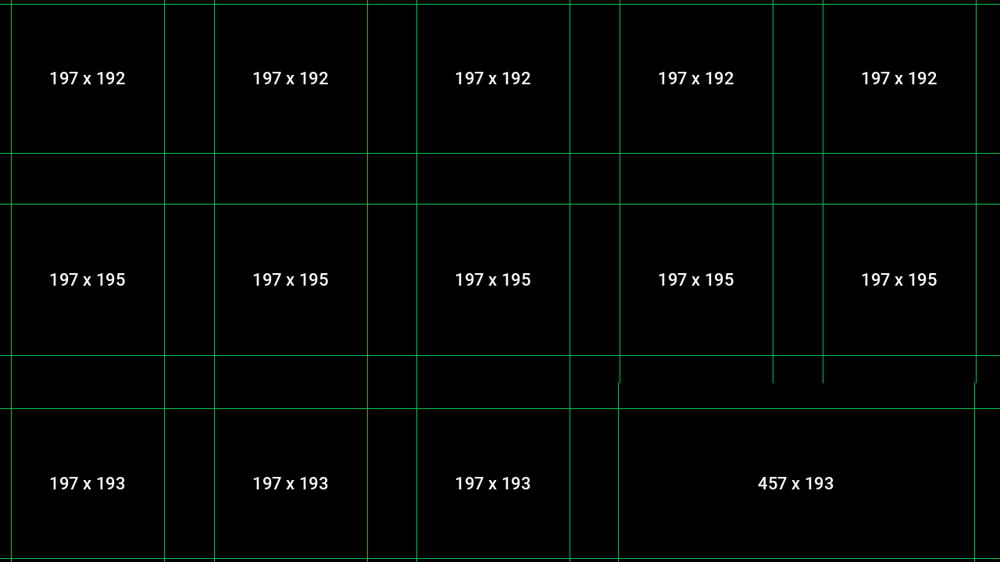

[← Part 5](../05-the-panel/README.md) · [All parts](../../README.md)

# Part 6 · Lining up the keys


> **Nobody setting a deck up does this.** The key positions are measured once and
> shipped with the software; the companion app installs them. This page is how they
> were measured, for anyone changing the hardware or curious about it.



The deck is one screen behind fourteen clear keys. Nothing in its software says where
on that screen each key's window is, so the only way to centre things in a key is to
find the windows by eye, on the deck itself.

This part is two short jobs you do once: teach the deck which key is which, and show
it where each key's edges are.

**You may not need it.** The repo ships with the positions measured on my deck. If
your keys look centred, stop here. I have only one deck, so I can't say how much they
vary from one to the next.

## At a glance

| | |
|---|---|
| **Built from** | Two modes of the bridge program ([Part 3](../03-mac-bridge/README.md)), and one small Python script |
| **Files in this folder** | `grid.json` (my deck's measurements) · `grid.png` (the same, as a picture) |
| **Also needs** | The deck app ([Part 2](../02-deck-app/README.md)) and the bridge ([Part 3](../03-mac-bridge/README.md)) installed. Python 3 for the last step |
| **Reads** | Your key presses |
| **Shows** | Lines on the deck that you move onto the key edges |

## What I found on my deck

| | |
|---|---|
| Single keys | 197 pixels wide, 192 to 195 tall |
| The wide key | 457 wide, 193 tall |
| Across | Columns start 259 or 260 pixels apart |
| Down | Rows start 256 and then 262 pixels apart: not even |
| The wide key | Starts 2 pixels left of the column above it |

Everything that looked like it should work, didn't: splitting the screen into equal
parts, a tidy grid, working it out from photographs, and the layout table inside the
vendor's own app, which was a few pixels out. Measuring on the deck was right first
time.

## Before either job

Both jobs talk to the deck directly, so stop the bridge that runs in the background:

```bash
launchctl bootout gui/$(id -u)/com.ulanzi-deck.bridge
```

The commands below use the built program. To save typing, go to its folder first:

```bash
cd ~/Library/Application\ Support/UlanziDeck
```

## Job 1 · Which key is which

Only needed if pressing a key sets off a different key's action.

```bash
./ulanzi-deck-bridge --keytest
```

When it says `Deck is listening`, press every key once in reading order: top row left
to right, middle row, bottom row, and the wide key last. After the fourteenth it
prints `Saved on the deck` and stops. The deck remembers the order from then on.

## Job 2 · Where the keys are

```bash
./ulanzi-deck-bridge --grid
```

The deck shows one white line, and five of its keys are labelled:

| Key on the deck | What it does |
|---|---|
| **Up**, **Down** | Move a level line |
| **Left**, **Right** | Move an upright line |
| **Next line** (the wide key) | Keep this line where it is and bring up the next |

1. Look at the key square-on. From an angle the line appears to slide.
2. Each line starts a little inside its key so you can see it. Nudge it outwards
   until it is the last row of pixels you can still see at that edge. Hold an arrow
   to keep it moving.
3. Press **Next line**. The line turns green and stays, and the next one appears.
4. There are eighteen: two for each column, two for the wide key, two for each row.
   The wide key counts them. After the last it reads **All done**.
5. Press Control-C in the terminal to finish.

To put one line right afterwards without redoing the rest, name it:

```bash
./ulanzi-deck-bridge --grid --only "row 2 top"
```

The names are `column 1 left` to `column 5 right`, `wide key left`, `wide key right`,
and `row 1 top` to `row 3 bottom`. Press **Done** on the wide key when it is right.

## Putting the measurements to use

The grid tool saves what you found on the Mac. This copies it into the integration.
Run it from the repo folder:

```bash
python3 tools/apply_grid.py
```

It prints the old and new positions and changes three lines in
`custom_components/ulanzi_deck/render.py`. Then:

1. Copy `custom_components/ulanzi_deck` to Home Assistant again, over the old one.
2. In Home Assistant, go to **Settings → Devices & services → Ulanzi Deck**, open the
   three-dot menu and choose **Reload**. No restart is needed.
3. Start the bridge again:

   ```bash
   launchctl bootstrap gui/$(id -u) ~/Library/LaunchAgents/com.ulanzi-deck.bridge.plist
   ```

The deck is sent its screens again as soon as the bridge reconnects, drawn to the new
positions.

## Settings I chose

- **You place the lines; nothing is worked out.** Every clever way of deriving the
  positions was wrong by enough to see.
- **The controls are on the deck**, labelled, so you never look away from the thing
  you are lining up.
- **One line at a time, and placed lines stay.** You watch the grid build up, and a
  line that is wrong is obvious against its neighbours.
- **Each key's picture runs 24 pixels past its window.** So no edge shows when you
  look from an angle. Content is centred on the middle of the window.

---

[← Part 5](../05-the-panel/README.md) · [All parts](../../README.md)
